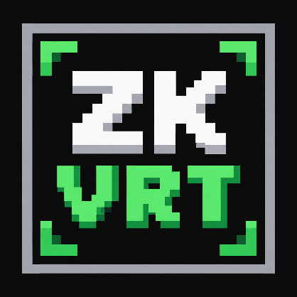
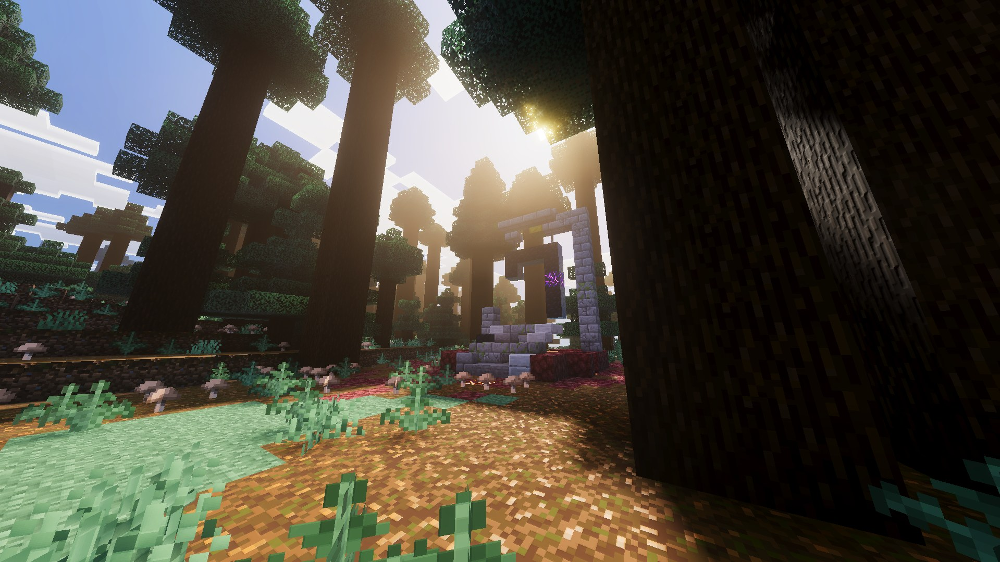
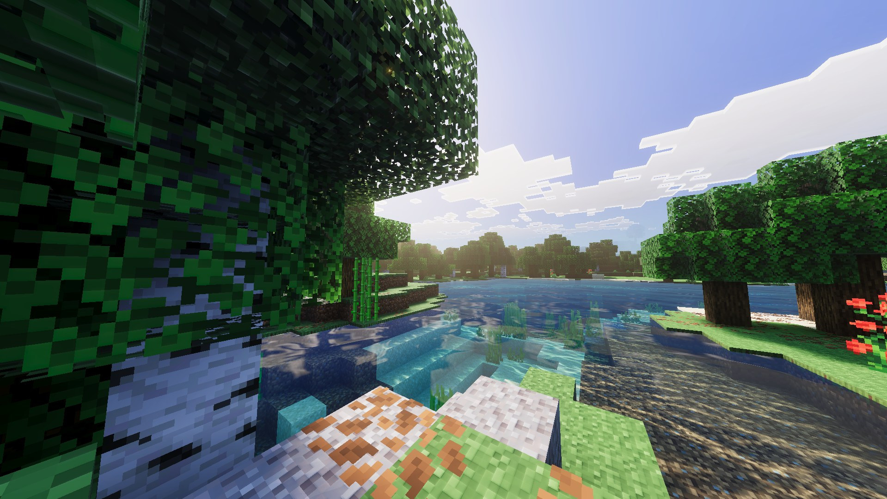
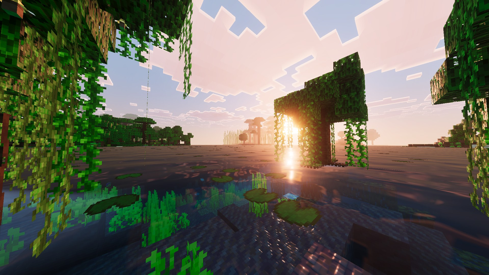
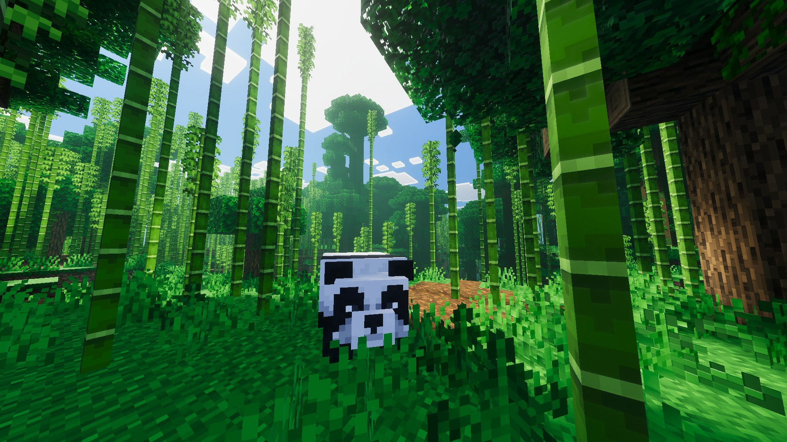
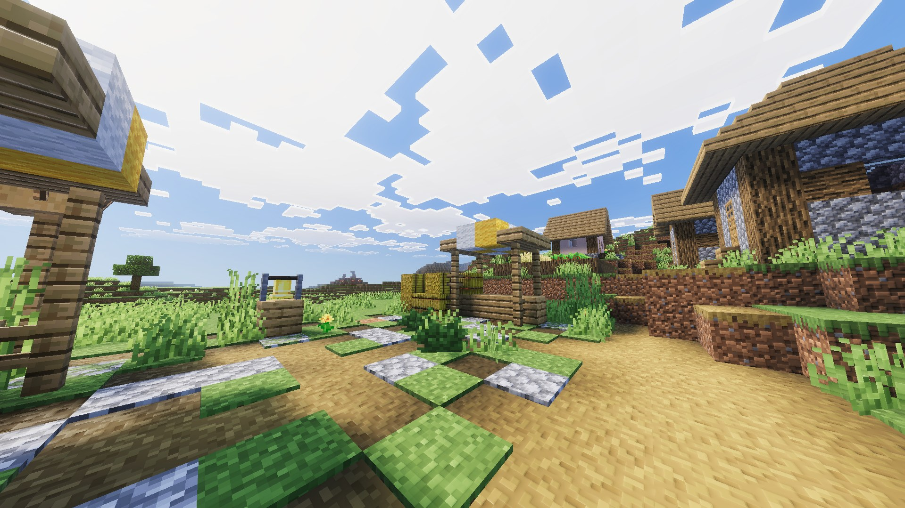

# ZK Vibrant

### Vanilla-friendly visual pack for Minecraft Bedrock

 

 

<b>📋 Table of Contents</b>

- [🧭 Overview](#overview)
- [🖼️ Screenshots](#screenshots)
- [⚙️ Features](#features)
- [📥 Download Now](#download-now)
- [🧩 Installation](#installation)
- [❓ FAQ](#faq)
- [✨ Special Thanks](#special-thanks)
- [📜 Terms of Use](#terms-of-use)
- [⚖️ Disclaimer](#disclaimer)

 

> [!NOTE]
> **Resource pack only** - ZK Vibrant is a visual pack for the Vibrant Visuals graphics mode. It is not a modified client and it does not change how the game plays.

> **Current Status** - The pack is in active development 🚀. New improvements arrive with every version.

 

---

<!-- OVERVIEW -->

<h1>Overview</h1>

<em>ZK Vibrant keeps the classic look of Minecraft Bedrock and makes it shine.</em>

<em>Richer colors, lively lighting, living water and polished visuals, all in a regular resource pack with no client modification required.</em>

 

---

<!-- SCREENSHOTS -->

<h1>Screenshots</h1>

<table>
  <tr>
    <td align="center"> <b>Giant taiga</b></td>
    <td align="center"> <b>Lake</b></td>
  </tr>
  <tr>
    <td align="center"> <b>Swamp sunset</b></td>
    <td align="center"> <b>Bamboo jungle</b></td>
  </tr>
  <tr>
    <td align="center" colspan="2"> <b>Village</b></td>
  </tr>
</table>

 

---

<!-- FEATURES -->

<h1>Features</h1>

<h3>🌅 Lighting and Atmosphere</h3>

| Feature | Description |
| :--- | :--- |
| **Lighting** | Tuned sun, moon and ambient light for warm days and deep nights. |
| **Soft Shadows** | Soft shadows that give depth to trees, builds and caves. |
| **Sky and Atmosphere** | Atmosphere settings for the sky, sunrise and sunset. |
| **Biome Fog** | A fog made for each biome, from dense swamps to open plains. |
| **Color Grading** | Color tuning that keeps the colors rich without losing the vanilla feel. |
| **Local Lighting** | Colored light from torches, lava and other light sources. |

 

<h3>🌊 Water</h3>

| Feature | Description |
| :--- | :--- |
| **Waves** | Animated waves that react to the light. |
| **Caustics** | Light patterns on the bottom of lakes and oceans. |
| **Biome Water** | Water color and clarity adjusted for each biome. |

 

<h3>🧱 Textures</h3>

| Feature | Description |
| :--- | :--- |
| **Vanilla Style** | The classic look of the game, redrawn to react to the new lighting. |
| **PBR Materials** | Normals, roughness and metalness on blocks and entities for real depth. |
| **Foliage Colors** | Custom grass and foliage colors for livelier biomes. |
| **Emissive Ores** | Ores glow in the dark. Optional, chosen in the pack settings. |

 

<h3>🔥 Nether and End</h3>

| Feature | Description |
| :--- | :--- |
| **Nether** | Lighting, atmosphere and fog that keep the terrain visible and the lava glowing. |
| **The End** | A purple sky and a visible ground, with its own atmosphere and fog. |

 

<em>🚀 And more, with new improvements being added in every version.</em>

 

---

<!-- DOWNLOAD -->

<h1>Download Now</h1>

&nbsp;&nbsp;

<em>Every release ships a ready to use <b>.mcpack</b> file and its changelog.</em>

 

---

<!-- INSTALLATION -->

<h1>Installation</h1>

| Step | What to do |
| :---: | :--- |
| **1** | Download the latest `.mcpack` file from the [releases page](https://github.com/Zev-Kaapor/ZK_Vibrant/releases/latest). |
| **2** | Open the file. Minecraft starts and imports the pack by itself. |
| **3** | Go to **Settings > Global Resources** and activate **ZK Vibrant** under *My Packs*. |
| **4** | Go to **Settings > Video** and set the graphics mode to **Vibrant Visuals**. |
| **5** | Optional: select the active pack and open its settings (gear icon) to choose between the two options below. |

 

| Option | Description |
| :--- | :--- |
| **Advanced PBR + Emissive Ores** | The default option. Ores glow in the dark. |
| **Advanced PBR** | The same pack with the regular ores. |

 

> [!TIP]
> **Updating?** Remove the old version from *Global Resources* and from *Storage* before importing the new one, so the game does not keep outdated files.

 

---

<!-- FAQ -->

<h1>FAQ</h1>

  
<b>Is ZK Vibrant free to use?</b>

   
  Yes, it is completely free. There are no paid versions or hidden costs.
    

  
<b>Do I need Vibrant Visuals?</b>

   
  Yes. The lighting, shadows, water and atmosphere only work with the Vibrant Visuals graphics mode turned on. Without it the pack only changes the textures.
    

  
<b>Is this a modified client or a hack?</b>

   
  No. It is only a resource pack that uses the tools the game already offers. It does not change the game files or how the game plays.
    

  
<b>Which version of Minecraft do I need?</b>

   
  The pack is built on the most recent version of Minecraft Bedrock. Older versions may not load some of the lighting files.
    

  
<b>Will it run on my device?</b>

   
  Vibrant Visuals is demanding. The pack has no lighter quality option, so weaker devices may lose performance. If that happens, lower the render distance in the video settings.
    

  
<b>What is the difference between the two options?</b>

   
  Only the ores. <b>Advanced PBR + Emissive Ores</b> makes ores glow in the dark, and <b>Advanced PBR</b> keeps them as regular blocks.
    

  
<b>Does it work with other resource packs?</b>

   
  Packs that change textures, lighting or atmosphere will override parts of ZK Vibrant. Use only one visual pack at a time for the best result.
    

  
<b>Something looks broken after a game update. What do I do?</b>

   
  Game updates can change how lighting files work. Check if there is a newer release of the pack, and if the problem remains, open an issue with a screenshot.
    

 

<h3>More questions? <a href="https://github.com/Zev-Kaapor/ZK_Vibrant/issues">Open an issue on GitHub!</a></h3>

 

---

<!-- ACKNOWLEDGMENTS -->

<h1>Special Thanks</h1>

<em>ZK Vibrant stands on the shoulders of incredible community work!</em>

 

| Project | Author | Contribution |
| :--- | :--- | :--- |
| **Vanilla Reforged** | QuirkyPlague | The base of the pack: textures, PBR materials, lighting, atmosphere, fog, color grading, water and biomes |
| **Vanilla Reforged Emissive Ores** | QuirkyPlague | Emissive ores |
| **Prizma Visuals** | Al3xis5 | Lighting, atmosphere and fog of the Nether and the End |
| **Minecraft** | Microsoft and Mojang Studios | Original game, textures and sounds |

 

<em>A huge thank you to <b>QuirkyPlague</b> and <b>Al3xis5</b> for their amazing work and for allowing it to be adapted into this pack. 💙</em>

 

---

<!-- TERMS OF USE -->

<h1>Terms of Use</h1>

| | Rule |
| :---: | :--- |
| ✅ | You may use and adapt this pack for personal use. |
| ✅ | When sharing changes, keep the credits of ZK Vibrant and the original authors. |
| ❌ | Do not redistribute this pack or modified versions on stores or monetization platforms without permission. |
| ❌ | Do not present the code or assets as your own creation. |
| ❌ | Do not reuse the parts made by the original authors without asking them first. |

 

---

<!-- DISCLAIMER -->

<h1>Disclaimer</h1>

ZK Vibrant is a non-commercial project developed for personal use. This project is **not affiliated with, funded, authorized, endorsed by, or associated** with Microsoft, Mojang Studios, or any of their affiliates and subsidiaries.

 

Minecraft and all related trademarks and assets belong to their respective owners.

 

---

 

**Made with 💙 by [Zev Kaapor](https://github.com/Zev-Kaapor)**

